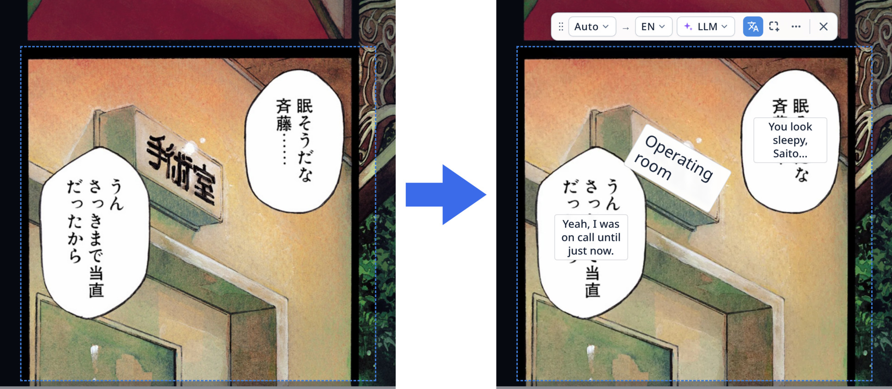
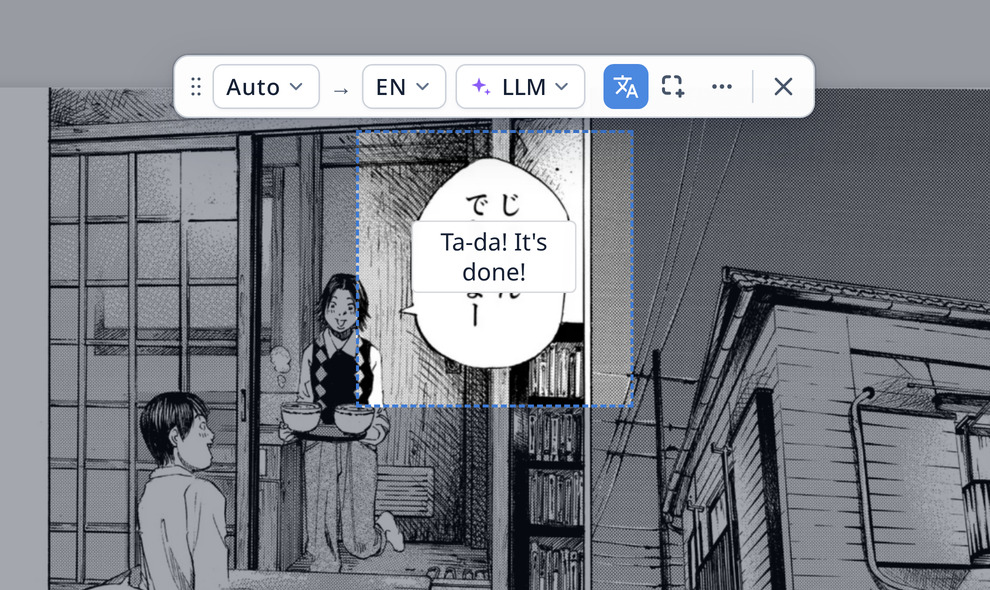
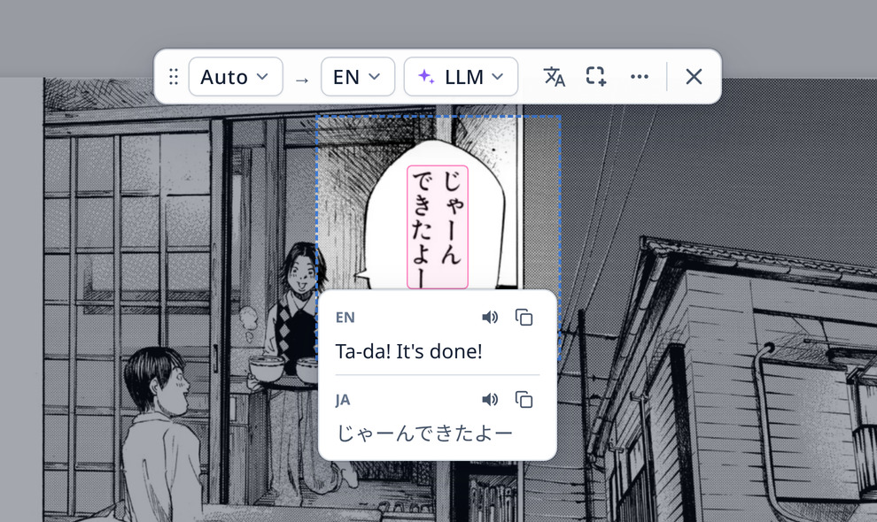
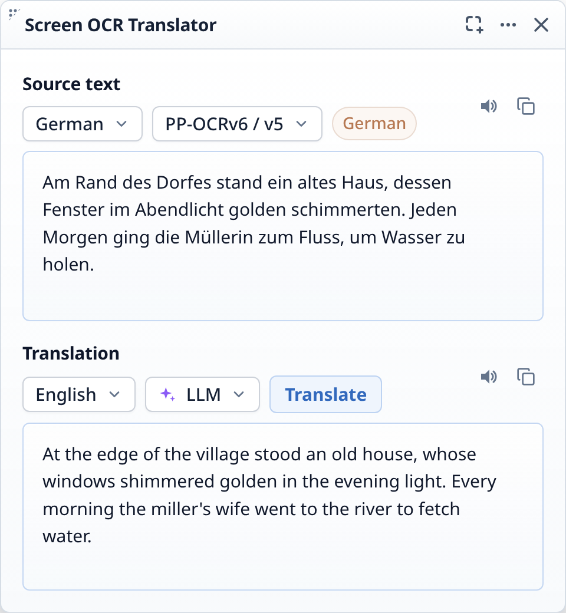
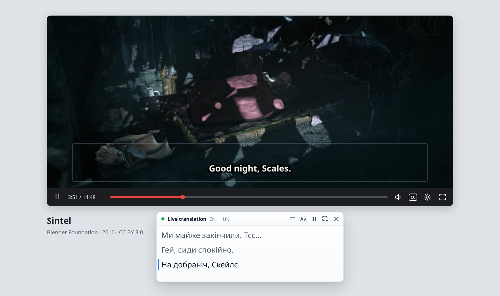

# Screen OCR Translator

<p>
  <a href="https://github.com/OPerepadia/ocr-translator-extension/actions/workflows/ci.yml"></a>
  <a href="https://github.com/OPerepadia/ocr-translator-extension/releases"></a>
  <a href="https://github.com/OPerepadia/ocr-translator-extension/blob/main/LICENSE"></a>
</p>

Browser extension that uses local OCR to extract text from images, comics, scans, or any selected area of a web page, and shows the translation in an overlay or in a panel.

<p align="center">
  
  <br>
  <sub>Comic: <a href="https://densho810.com/free/">Give My Regards to Black Jack</a>, SHUHO SATO.</sub>
</p>

Translation uses Google Translate by default. You can also use DeepL (with your own API key) or any OpenAI-compatible LLM endpoint (local or remote).

## Install

<p align="center">
  <a href="https://addons.mozilla.org/firefox/addon/screen-ocr-translator/"></a>
  <a href="https://chromewebstore.google.com/detail/screen-ocr-translator/legljemohhhablgapleoakcepoofloae"></a>
</p>

## Features

- Select any area of a web page and translate it in place.
- Translate an image directly from the context menu.
- Translate a screen area live, such as hardcoded video subtitles.
- Run OCR locally in your browser with bundled [PaddleOCR](https://github.com/PaddlePaddle/PaddleOCR) models.
- Wide language support with automatic script detection. See [supported languages](#text-recognition).
- Group recognized lines into speech bubbles and free-text regions with a [local layout model](docs/LAYOUT-GROUPING.md).
- Choose a translation provider:
    - Google Translate (no API key required)
    - DeepL (requires your own [DeepL API key](https://www.deepl.com/your-account/keys))
    - Any OpenAI-compatible LLM endpoint, such as llama.cpp or Ollama. See [LLM setup](#llm-setup).
- Copy or listen to the text, or compare the original and translation side by side.

## Usage

1. Open the extension from the toolbar or context menu, or use a keyboard shortcut.
2. Drag to select an area, or click an image to translate it.
3. The translation appears over the selected area.

Keyboard shortcuts:

- Chrome: `Ctrl+Shift+F` by default.
- Firefox: no default, because Firefox 159+ reserves it for the add-ons manager.

You can set or change a shortcut in the extension settings.

You can also right-click an image and choose **Translate this image**.

To move or resize the area before recognition starts, enable **Adjust selection before recognition** in the extension settings.

### Overlay view

The overlay has two views:

- **Translated text** (default): the translation is drawn over the original text.
- **Original image**: the captured image without the translation, with the text blocks highlighted.

Press `Shift` or click the translate button in the toolbar to toggle the view. Hover over a text block to see its translation and the original text.

<table align="center">
  <tr>
    <th align="center">Translated text (default)</th>
    <th align="center">Original image, hovering a text block</th>
  </tr>
  <tr>
    <td align="center">
      <a href="media/demo-overlay.jpg"></a>
    </td>
    <td align="center">
      <a href="media/demo-hover.jpg"></a>
    </td>
  </tr>
</table>

<p align="center">
  <sub>Comic: <a href="https://densho810.com/free/">Give My Regards to Black Jack</a>, SHUHO SATO.</sub>
</p>

To change which view opens by default, set **Initial overlay view** in Settings > Display.

### Panel view

To show results in a panel, choose **Panel** in the extension popup. It appears in the bottom right corner of the screen. You can also temporarily switch to the panel view from the ⋯ menu in the overlay toolbar.

<p align="center">
  
</p>

In the panel view, you can edit the recognized text to fix mistakes, or change the language, recognition model, or translation provider.

### Local image files

To use the extension on local image files, grant access to local files:

- Firefox: open the add-on's **Permissions and data** settings and enable **Access local files on your computer**.
- Chrome: open the extension details and enable **Allow access to file URLs**.

Then reload the image and try again.

## Live translation

Translate a screen area in real time, such as hardcoded video subtitles.

1. Click **Live translation** in the extension popup.
2. Drag to select the area containing the text.
3. The translation appears in a small panel next to the selected area.

<p align="center">
  
  <br>
  <sub>Video: <a href="https://durian.blender.org/">Sintel</a>, © Blender Foundation | durian.blender.org, <a href="https://creativecommons.org/licenses/by/3.0/">CC BY 3.0</a>.</sub>
</p>

Tips:

- Select the area while subtitles are visible. The extension learns the subtitle size from the first capture and ignores much smaller text.
- The extension reads directly from the video frame when possible, and falls back to a screenshot otherwise. In screenshot mode, keep the panel clear of the selected area; the extension will warn you if it's in the way.
- When using an LLM endpoint, the previous few lines and their translations are included as context to improve translation quality.
- DRM-protected videos may not work.

## Supported languages

### Text recognition

The extension bundles several recognizer models. The general recognizer is [PP-OCRv6](https://www.paddleocr.ai/main/en/version3.x/algorithm/PP-OCRv6/PP-OCRv6.html). It's a multilingual model that supports 50 languages and provides the best accuracy. Other scripts use separate PP-OCRv5 recognizers.

| Model | Recognized languages |
|---|---|
| PP-OCRv6 (multilingual) | Afrikaans, Albanian, Azerbaijani, Basque, Bosnian, Catalan, Chinese (Simplified & Traditional), Croatian, Czech, Danish, Dutch, English, Estonian, Finnish, French, German, Hungarian, Icelandic, Indonesian, Irish, Italian, Japanese, Latvian, Lithuanian, Malay, Norwegian, Polish, Portuguese, Romanian, Serbian (Latin), Slovak, Slovenian, Spanish, Swahili, Swedish, Tagalog, Turkish, Uzbek, Vietnamese, Welsh |
| Cyrillic-PP-OCRv5 | Belarusian, Bulgarian, Kazakh, Macedonian, Mongolian, Russian, Serbian (Cyrillic), Ukrainian |
| Korean-PP-OCRv5 | Korean |
| Arabic-PP-OCRv5 | Arabic, Pashto, Persian, Urdu |
| Devanagari-PP-OCRv5 | Hindi, Marathi, Nepali |
| PP-OCRv6 Manga | Same as PP-OCRv6; fine-tuned on Japanese and Chinese manga by [Kellenok](https://huggingface.co/Kellenok/PP-OCRv6_manga) |

When the source language is set to Auto, a local classifier detects the script and selects the matching recognizer.

### Translation

Recognized text can be translated into any language supported by your chosen translation provider.

To use an LLM for translation, see [LLM setup](#llm-setup).

## Limitations

Recognized text lines are grouped into regions using a bundled RT-DETR model.
It may still miss or incorrectly group very small text, tables, or dense multi-column layouts.
Selecting a smaller area can improve results.

## LLM setup

The **LLM** translation provider works with any server that has an OpenAI-compatible chat completions API, whether it runs on your computer or is a hosted service.

1. Start your server, or get an API key for a hosted service.
2. In the extension settings, set **Translation provider** to **LLM**.
3. Enter the **Endpoint URL**. It usually ends in `/v1`.
4. Enter an **API key** if the server requires one.
5. Click **Fetch models** and pick a model.
6. Click **Test connection**.

Default endpoints of common servers:

| Server | Endpoint URL | Notes |
|---|---|---|
| [llama.cpp](https://llama.app/) | `http://localhost:8080/v1` | For live translation, start the server with `--cache-ram 0` to prevent the growing RAM usage (see [Troubleshooting](#troubleshooting)). |
| [Ollama](https://ollama.com/) | `http://localhost:11434/v1` | Turn on **Remove Origin header**, or Ollama answers with HTTP 403. |
| [LM Studio](https://lmstudio.ai/) | `http://localhost:1234/v1` | Start the local server in LM Studio first. |
| [OpenRouter](https://openrouter.ai/) | `https://openrouter.ai/api/v1` | Needs an API key. |
| OpenAI | `https://api.openai.com/v1` | Needs an API key. Also turn off **Disable model thinking**. |

## Troubleshooting
 
### Translation
 
| Problem | What to do |
|---|---|
| *Couldn't reach the LLM endpoint* | Check that the server is running and that the URL, port, and `http`/`https` are correct. |
| *Invalid translation format after a retry* | The model isn't following the JSON format. This often happens with smaller models. Try a larger or instruction-tuned model. |
| Ollama returns HTTP 403 | Turn on **Remove Origin header** in the LLM settings. |
| RAM usage grows while using llama.cpp | Start the server with `--cache-ram 0`. This turns off the prompt cache, which keeps copies of earlier prompts in RAM. |
| LLM request failed (HTTP 400) from a hosted LLM API | Turn off **Disable model thinking**, and check that the model name is correct. |
| Google Translate times out | Try again, or switch to another provider. Google may rate-limit frequent requests. |
 
### Recognition
 
| Problem | What to do |
|---|---|
| Nothing happens on a local image file | Grant the extension access to local files. See [Local image files](#local-image-files). |
| The first recognition takes 15–20 seconds in Firefox on Windows | This is slow WebGPU shader compilation in Firefox. Turn off **GPU acceleration** in settings. See [issue #18](https://github.com/OPerepadia/ocr-translator-extension/issues/18). |
| *Insufficient memory* error | Close GPU-heavy tabs, or turn off **GPU acceleration**. |
| Text is missed or grouped wrongly | Select a smaller area. For comics, try the manga recognition model. |

## WebGPU setup

> [!WARNING]
> GPU acceleration is experimental. Depending on your browser, OS and hardware, it may make text recognition faster or slower.
> The flags below enable WebGPU for all websites and can cause crashes or instability, so use them at your own risk.

### Firefox

1. Open `about:config`.
2. Set `dom.webgpu.enabled` to `true`.
3. Restart the browser.

See the [Firefox guide on enableGPU.com](https://enablegpu.com/guides/firefox/)
for a walkthrough.

> [!NOTE]
> In Firefox on Windows, with GPU acceleration enabled, the first recognition can take 15–20 seconds.
> The cause is slow shader compilation in Firefox, which needs to be fixed upstream.
> Until then, turn off **GPU acceleration** in the extension settings if this bothers you.
> See [issue #18](https://github.com/OPerepadia/ocr-translator-extension/issues/18).

### Chromium

1. Open `chrome://flags`.
2. Enable both of these flags:
    - **Unsafe WebGPU Support** (`chrome://flags/#enable-unsafe-webgpu`)
    - **Vulkan** (`chrome://flags/#enable-vulkan`)
3. Restart the browser.

## Privacy

- Captured images are processed locally.
- Recognized text is sent to the selected translation provider for translation.
- Settings and API keys are stored locally. An API key is sent only to the
  endpoint configured by the user.

See the [Privacy Policy](PRIVACY.md) for details.

## Development

Built with [WXT](https://wxt.dev/) and TypeScript.

```sh
npm ci
npm run dev         # Firefox
npm run dev:chrome  # Chrome
```

Dev mode launches the browser with the extension installed and reloads it on changes.

To test a production build, run:

```sh
npm run build         # Firefox
npm run build:chrome  # Chrome
```

The builds generate unpacked extensions in `.output/firefox-mv3` and `.output/chrome-mv3`.

- Firefox: load the directory as a temporary add-on. See [Temporary installation in Firefox](https://extensionworkshop.com/documentation/develop/temporary-installation-in-firefox/).
- Chrome: load the directory via **Load unpacked** on `chrome://extensions` with Developer mode on.

Run the test suite and type checks with:

```sh
npm test
npm run typecheck
```

### Firefox for Android

Enable Android USB debugging and in Firefox Settings, enable **Remote debugging via USB**. Connect the device and run:

```sh
# Get the device serial
adb devices

# Load the extension
npm run run:android -- --adb-device DEVICE_SERIAL
```

The installation is temporary and lasts until Firefox restarts.

## Localization

Translations are stored in `src/public/_locales/<locale>/messages.json`.

Some locales were initially machine-translated and may need improvement. Contributions and corrections from native speakers are welcome.

## License

Copyright (C) 2026 Oleksandr Perepadia

Screen OCR Translator is licensed under the [Mozilla Public License 2.0](LICENSE).
Bundled libraries, runtime files, and OCR models retain their original licenses. See [THIRD_PARTY_NOTICES.md](THIRD_PARTY_NOTICES.md).

The demo images use third-party artwork licensed for free reuse under the terms linked below:

- Comic: [Give My Regards to Black Jack](https://densho810.com/free/), SHUHO SATO, used under the publisher's free-use terms.
- Video: [Sintel](https://durian.blender.org/), © Blender Foundation | durian.blender.org, [CC BY 3.0](https://creativecommons.org/licenses/by/3.0/).
